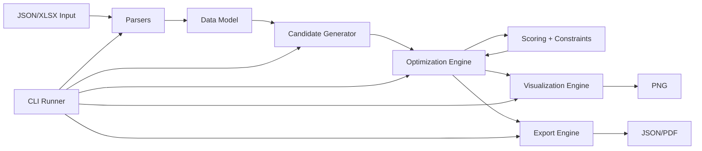

# Plant AutoLayout Engine

Plant AutoLayout Engine is a preliminary plant-layout decision-support tool for generating, comparing, visualizing, and exporting conceptual equipment layouts from structured JSON or Excel inputs.

Current supported profiles are **WTP (Water Treatment Plant)** and **Petrochemical**. For the generalized architecture, input formats, scoring, and UI workflow, see [GENERALIZED_ENGINE_GUIDE.md](GENERALIZED_ENGINE_GUIDE.md). The original WTP implementation is described in [FULL_ENGINE_GUIDE.md](FULL_ENGINE_GUIDE.md).

This software does not provide regulatory compliance, hydraulic design or simulation, detailed piping design, or construction-ready engineering. Petrochemical distances and engineering rules must be supplied and validated by qualified users; the engine does not infer regulatory separation requirements.

## Major Features

- JSON and Excel project input for WTP and petrochemical concept layouts
- Site boundaries, zones, existing structures, corridors, groups, flows, and proximity rules
- Constraint checking, candidate generation, scoring, and lightweight optimization
- Static and interactive visualization
- JSON, PNG, PDF, and HTML result exports
- Streamlit editor and command-line workflow

## Quick Demo

```bash
python -m pip install -r requirements.txt
python -m streamlit run app.py
```

In the Streamlit app, choose **Load Sample**, select either the Water Treatment Plant or Petrochemical sample, review the staged project inputs, run the layout optimization, and download the generated results.

For a command-line demo:

```bash
python -m wtp_autolayout.cli.main --input sample_data/sample_wtp_input.json --output outputs --algorithm simulated_annealing --candidate-count 10 --iterations 100 --seed 42 --verbose
```

This repository currently implements:

- Phase 1: Engineering Data Model
- Phase 2: Structured JSON and Excel input parsers
- Phase 3: Shapely-backed Geometry Engine
- Phase 4: Constraint Engine that returns engineering `Violation` objects
- Phase 5: Scoring Engine for violation penalties and layout scores
- Phase 6: Candidate Generator for initial feasible placements
- Phase 7: Optimization Engine for ranked candidates and simple refinement
- Phase 8: Visualization Engine for engineering-style layout plots
- Phase 9: Export Engine for JSON, PNG, and PDF reports
- Phase 10: Final CLI integration from input file to engineering outputs

The implementation is aligned with the SRDS phased approach and targets Python 3.9.

It does not implement APIs, PDF parsing, GeoPandas, NetworkX, FastAPI, OR-Tools, CAD/DXF export, or BIM/IFC export. A Streamlit editor is included.

## Generalized Samples

```bash
python -m wtp_autolayout.cli.main --input sample_data/sample_general_wtp_input.json --output outputs/wtp --algorithm ranked --candidate-count 3 --seed 42
python -m wtp_autolayout.cli.main --input sample_data/sample_petrochemical_input.xlsx --output outputs/petro --algorithm ranked --candidate-count 3 --seed 42
python -m streamlit run app.py
```

On Windows, `launch_plant_ui.bat` starts the same editor. The legacy `launch_wtp_ui.bat` remains available.

The UI stages are Project Setup, Site Boundary, Site Features, System Groups, Units, Flow, Proximity, Corridors / Roads, Optimization Settings, and Results. The boundary editor only asks for Easting and Northing. Unordered convex perimeter points are ordered automatically; concave boundaries require explicit `vertex_order` in JSON/XLSX.

Optional JSON sections include `plant_type`, `system_groups`, `proximity_relationships`, `site_zones`, `existing_structures`, `corridors`, `group_relationships`, and `engineering_rules`. Excel equivalents are `Project`, `Groups`, `Proximity`, `SiteZones`, `ExistingStructures`, `Corridors`, `GroupRelationships`, and `EngineeringRules` sheets. Polygon `vertices` and corridor `path` are JSON coordinate arrays in Excel cells. Old WTP files without `plant_type` default to WTP, and legacy `vertex_order` is honored. `Constraints` remains optional.

Site zones and fixed structures are never optimized. Hard zones, fixed structures, and hard corridors exclude movable unit footprints plus their clearances. Soft zones contribute occupancy penalties. Width-aware access/road corridors support explicit unit access-distance rules; legacy `Road` rows still work as access paths. Routing/utility corridors are a preference in the preliminary display router, not a hydraulic design rule. Group-to-group distances use the nearest member footprint gap. See [GENERALIZED_ENGINE_GUIDE.md](GENERALIZED_ENGINE_GUIDE.md) for the complete site input example and rule semantics.

Each relationship has `relationship_id`, `unit_id_a`, `unit_id_b`, `relationship_type`, `distance`, `classification`, and `weight`. `min_distance` and `max_distance` compare footprint gaps; `target_distance` penalizes absolute deviation; `preferred_near` is a soft maximum-distance preference. Hard relationship violations affect feasibility. The score uses a 65-point base plus up to 35 reward points, minus hard and soft penalties.

## Known Limitations

- Preliminary decision support only; professional engineering review is required
- No regulatory compliance or separation-distance determination
- No CAD/DXF export yet
- No hydraulic design or simulation
- No detailed piping design or stress analysis
- No PDF extraction
- No final construction drawing generation

## Package Structure

```text
wtp_autolayout/
  models/
    coordinate.py
    boundary.py
    engineering_unit.py
    placement.py
    constraint.py
    violation.py
    flow.py
    infrastructure.py
    layout.py
    optimization.py
  utils/
    serialization.py
  parsers/
    errors.py
    json_parser.py
    excel_parser.py
    validation.py
    sample_schema.py
  geometry/
    errors.py
    shapes.py
    engine.py
    clearance.py
  constraints/
    errors.py
    base.py
    geometry_constraints.py
    engineering_constraints.py
    engine.py
  scoring/
    errors.py
    weights.py
    result.py
    engine.py
  candidates/
    errors.py
    strategies.py
    generator.py
  optimization/
    errors.py
    result.py
    local_search.py
    annealing.py
    engine.py
  visualization/
    errors.py
    styles.py
    renderer.py
  export/
    errors.py
    json_exporter.py
    image_exporter.py
    pdf_exporter.py
  cli/
    main.py
    runner.py
sample_data/
  sample_wtp_input.json
  sample_wtp_input.xlsx
outputs/
  .gitkeep
tests/
  test_models.py
  test_parsers.py
  test_geometry.py
  test_constraints.py
  test_scoring.py
  test_candidates.py
  test_optimization.py
  test_visualization_export.py
  test_cli.py
```

## Installation

Create an environment with Python 3.9 or newer compatible Python 3.x, then install the project dependencies:

```bash
python -m pip install -r requirements.txt
```

## Dependencies

The implementation uses only the packages needed by the implemented phases:

- `pandas` and `openpyxl` for Excel input
- `shapely` for geometry checks
- `matplotlib` for static layout rendering
- `reportlab` for PDF report export
- `plotly` for interactive HTML layout rendering
- `streamlit` for the optional local UI

## Phase 2 Parser Usage

Parse JSON:

```python
from wtp_autolayout.parsers import parse_json_file

layout = parse_json_file("sample_data/sample_wtp_input.json")
print(layout.boundary.boundary_id)
print([unit.unit_id for unit in layout.units])
```

Parse Excel:

```python
from wtp_autolayout.parsers import parse_excel_file

layout = parse_excel_file("sample_data/sample_wtp_input.xlsx")
print(len(layout.flow_graph.edges))
```

Parser failures raise `ParserError` with a clear message.

## JSON Schema Example

```json
{
  "boundary": [
    {
      "boundary_id": "B-001",
      "coordinate_system": "local_grid_m",
      "easting": 0.0,
      "northing": 0.0,
      "elevation": null,
      "vertex_order": 1
    }
  ],
  "units": [
    {
      "unit_id": "clarifier",
      "name": "Clarifier",
      "category": "process",
      "shape_type": "circle",
      "diameter": 28.0,
      "required_clearance": 5.0,
      "system_group": "clarification",
      "hazard_level": "low",
      "process_order": 4,
      "metadata": {}
    }
  ],
  "flow_edges": [
    {
      "edge_id": "F-001",
      "source_unit_id": "raw_water_inlet",
      "target_unit_id": "clarifier",
      "flow_type": "process_water",
      "gravity_required": true,
      "weight": 1.0,
      "metadata": {}
    }
  ],
  "constraints": [
    {
      "constraint_id": "C-001",
      "name": "Boundary Containment",
      "constraint_type": "boundary",
      "classification": "hard",
      "severity": "critical",
      "weight": 1.0,
      "enabled": true,
      "description": "All units must remain inside the project boundary."
    }
  ],
  "optimization_settings": {
    "layout_mode": "balanced"
  },
  "metadata": {
    "project_name": "Sample WTP"
  }
}
```

## Excel Sheet Structure

Required sheets:

- `Boundary`: `boundary_id`, `coordinate_system`, `easting`, `northing`, optional `elevation`, optional `vertex_order`
- `Units`: `unit_id`, `name`, `category`, `shape_type`, optional dimensions, `required_clearance`, `system_group`, `hazard_level`, optional `process_order`, optional `metadata`
- `Flow`: `edge_id`, `source_unit_id`, `target_unit_id`, `flow_type`, `gravity_required`, `weight`, optional `metadata`
- `Constraints`: `constraint_id`, `name`, `constraint_type`, `classification`, `severity`, `weight`, `enabled`, `description`

Optional sheets:

- `Roads`
- `Drains`
- `OptimizationSettings`
- `Metadata`

`OptimizationSettings` and `Metadata` use simple `key` and `value` columns.

## Phase 3 Geometry Engine Usage

```python
from wtp_autolayout.geometry import GeometryEngine
from wtp_autolayout.models import Coordinate, Placement
from wtp_autolayout.parsers import parse_json_file

layout = parse_json_file("sample_data/sample_wtp_input.json")

# Parser input may omit placements. Add candidate placements before geometry validation.
layout.placements = [
    Placement("P-001", "raw_water_inlet", Coordinate(20.0, 20.0)),
    Placement("P-002", "cascade_aerator", Coordinate(45.0, 20.0)),
]

engine = GeometryEngine()
result = engine.validate_layout_geometry(layout)

print(result.to_dict())
```

The geometry engine can:

- convert `Boundary` vertices to a Shapely `Polygon`
- create rectangular, square, and circular unit footprints from `EngineeringUnit` and `Placement`
- rotate rectangle and square footprints using `Placement.rotation`
- create clearance buffers using `EngineeringUnit.required_clearance`
- check boundary containment, overlaps, distances, and clearance violations
- validate a `Layout` without mutating it

## Phase 4 Constraint Engine Usage

```python
from wtp_autolayout.constraints import default_wtp_engine
from wtp_autolayout.models import Coordinate, Placement
from wtp_autolayout.parsers import parse_json_file

layout = parse_json_file("sample_data/sample_wtp_input.json")

# Candidate placements are required before geometric and engineering constraints can run.
layout.placements = [
    Placement("P-001", "raw_water_inlet", Coordinate(20.0, 20.0, elevation=105.0)),
    Placement("P-002", "cascade_aerator", Coordinate(45.0, 20.0, elevation=104.0)),
    Placement("P-003", "flash_mixer", Coordinate(70.0, 20.0, elevation=103.0)),
]

engine = default_wtp_engine()
violations = engine.evaluate_enabled(layout)

for violation in violations:
    print(violation.constraint_id, violation.affected_units, violation.penalty)
```

The default WTP constraint engine includes:

- boundary containment
- engineering unit overlap
- minimum clearance
- geometry validity
- sludge isolation
- chemical safety
- residential separation
- process adjacency
- gravity flow

Phase 4 only returns individual `Violation` objects.

## Phase 5 Scoring Engine Usage

```python
from wtp_autolayout.constraints import default_wtp_engine
from wtp_autolayout.models import Coordinate, Placement
from wtp_autolayout.parsers import parse_json_file
from wtp_autolayout.scoring import ScoringEngine

layout = parse_json_file("sample_data/sample_wtp_input.json")

layout.placements = [
    Placement("P-001", "raw_water_inlet", Coordinate(20.0, 20.0, elevation=105.0)),
    Placement("P-002", "cascade_aerator", Coordinate(45.0, 20.0, elevation=104.0)),
    Placement("P-003", "flash_mixer", Coordinate(70.0, 20.0, elevation=103.0)),
]

constraint_engine = default_wtp_engine()
scoring_engine = ScoringEngine(constraint_engine=constraint_engine)

result = scoring_engine.score_layout(layout)
print(result.score)
print(result.total_penalty)
print(result.penalty_by_constraint)
```

The scoring engine:

- evaluates constraints when a `ConstraintEngine` is supplied
- separates hard and soft penalties
- groups penalties by constraint and severity
- computes a Version 2 multi-objective engineering score
- rewards hydraulic transfer efficiency, gravity-friendly elevations, cluster arrangement, compactness, and expansion allowance
- ranks layouts by score
- can optionally update compatible layout fields with `update_layout=True`

Penalty-only `score_violations()` remains available for backward-compatible violation scoring.

## Phase 6 Candidate Generator Usage

```python
from wtp_autolayout.candidates import CandidateGenerator
from wtp_autolayout.constraints import default_wtp_engine
from wtp_autolayout.parsers import parse_json_file
from wtp_autolayout.scoring import ScoringEngine

layout = parse_json_file("sample_data/sample_wtp_input.json")

generator = CandidateGenerator(random_seed=42)
candidate = generator.generate(layout)

print(candidate.layout_id)
print(len(candidate.placements))
```

Optionally score a generated candidate:

```python
constraint_engine = default_wtp_engine()
scoring_engine = ScoringEngine(constraint_engine=constraint_engine)

generator = CandidateGenerator(random_seed=42, scoring_engine=scoring_engine)
candidate = generator.generate(layout, score_generated=True)

print(candidate.optimization_score)
```

The candidate generator:

- creates missing placements for every engineering unit
- preserves existing valid placements unless `replace_existing=True`
- supports `FIT`, `SHRINK`, and `BALANCED` layout modes
- avoids boundary violations, overlaps, and clearance violations during generation
- can generate multiple initial candidates with reproducible randomness

Phase 6 is not the final optimizer.

## Phase 7 Optimization Engine Usage

```python
from wtp_autolayout.candidates import CandidateGenerator
from wtp_autolayout.constraints import default_wtp_engine
from wtp_autolayout.optimization import Optimizer
from wtp_autolayout.parsers import parse_json_file
from wtp_autolayout.scoring import ScoringEngine

layout = parse_json_file("sample_data/sample_wtp_input.json")

constraint_engine = default_wtp_engine()
scoring_engine = ScoringEngine(constraint_engine=constraint_engine)
candidate_generator = CandidateGenerator(random_seed=42)

optimizer = Optimizer(
    candidate_generator=candidate_generator,
    scoring_engine=scoring_engine,
    random_seed=42,
    initial_candidate_count=5,
    max_iterations=50,
    algorithm="simulated_annealing",
)

result = optimizer.optimize(layout)

print(result.status)
print(result.best_score_result.score)
print(result.best_layout.layout_id)
```

Available algorithms:

- `ranked`: generate and score candidates, then return the ranked list without refinement
- `local_search`: repeatedly tries small feasible placement moves and accepts score improvements
- `simulated_annealing`: accepts improvements and sometimes worse feasible moves according to temperature

Phase 7 produces optimized/ranked `Layout` objects and score summaries.

## Phase 8 Visualization Engine Usage

```python
from wtp_autolayout.candidates import CandidateGenerator
from wtp_autolayout.models import LayoutMode
from wtp_autolayout.parsers import parse_json_file
from wtp_autolayout.visualization import LayoutRenderer

layout = parse_json_file("sample_data/sample_wtp_input.json")
candidate = CandidateGenerator(
    random_seed=1,
    max_attempts_per_unit=3000,
).generate(layout, mode=LayoutMode.FIT)

renderer = LayoutRenderer(show_flow=True, show_labels=True, show_clearance=False)
renderer.save_png(candidate, "outputs/sample_layout.png", title="Sample WTP Layout")
```

The renderer draws:

- site boundary polygon
- engineering unit footprints
- unit labels
- process flow arrows
- optional clearance buffers
- optional violation markers
- legend, north arrow, and equal aspect ratio

## Phase 9 Export Engine Usage

```python
from wtp_autolayout.candidates import CandidateGenerator
from wtp_autolayout.constraints import default_wtp_engine
from wtp_autolayout.export import ImageExporter, JSONExporter, PDFExporter
from wtp_autolayout.models import LayoutMode
from wtp_autolayout.parsers import parse_json_file
from wtp_autolayout.scoring import ScoringEngine

layout = parse_json_file("sample_data/sample_wtp_input.json")
candidate = CandidateGenerator(
    random_seed=1,
    max_attempts_per_unit=3000,
).generate(layout, mode=LayoutMode.FIT)

scoring_engine = ScoringEngine(default_wtp_engine())
scoring_engine.score_layout(candidate, update_layout=True)

JSONExporter().export_layout(candidate, "outputs/sample_layout.json")
ImageExporter().export_png(candidate, "outputs/sample_layout.png", title="Sample WTP Layout")
PDFExporter().export_layout_report(
    candidate,
    "outputs/sample_layout_report.pdf",
    title="Sample WTP Report",
)
```

The export engine creates parent directories as needed and supports:

- layout JSON export
- optimization runtime result JSON export
- PNG layout export
- simple PDF layout reports with score, counts, violation summary, and optional embedded image

DXF/CAD export, BIM/IFC export, and API routes remain outside the current implementation.

## Engineering Knowledge Base

The knowledge base centralizes WTP engineering relationships used by scoring and candidate generation:

```python
from wtp_autolayout.knowledge import get_cluster, get_relationship

print(get_cluster("flash mixer"))
print(get_relationship("flash mixer", "drop chamber"))
```

It includes hydraulic, sludge, chemical, and clear-water clusters plus preferred adjacency and separation rules.

## Interactive Plotly Rendering

```python
from wtp_autolayout.visualization import PlotlyLayoutRenderer

renderer = PlotlyLayoutRenderer(show_flow=True, show_clearance=True)
renderer.export_html(candidate, "outputs/optimized_layout.html", title="Interactive WTP Layout")
```

The interactive renderer supports zoom, pan, legend layer toggles, unit hover metadata, and pipe hover metadata.

## Streamlit UI

Run the optional local UI:

```bash
python -m streamlit run app.py
```

The UI supports project upload, boundary/unit/flow editing tables, optimization settings, an interactive Plotly result, and downloads for PDF, PNG, JSON, and HTML outputs.

## Phase 10 CLI Usage

Run the full pipeline from JSON input:

```bash
python -m wtp_autolayout.cli.main --input sample_data/sample_wtp_input.json --output outputs
```

Run the full pipeline from Excel input:

```bash
python -m wtp_autolayout.cli.main --input sample_data/sample_wtp_input.xlsx --output outputs --algorithm ranked --candidate-count 5
```

Common CLI arguments:

- `--input`: JSON or XLSX project file
- `--output`: output directory
- `--algorithm`: `ranked`, `local_search`, or `simulated_annealing`
- `--layout-mode`: `FIT`, `SHRINK`, or `BALANCED`
- `--candidate-count`: number of initial candidate layouts, default `10`
- `--iterations`: refinement iterations, default `100`
- `--seed`: optional random seed
- `--no-pdf`: disable PDF export
- `--no-png`: disable PNG export
- `--no-json`: disable JSON exports
- `--verbose`: print progress and Python tracebacks for debugging

Expected output files when all exports are enabled:

```text
outputs/
  optimized_layout.png
  optimized_layout.pdf
  optimized_layout.json
  optimization_result.json
```

Example screenshot path after running the JSON example:

```text
outputs/optimized_layout.png
```

Project architecture:



## Run Tests

```bash
python -m unittest discover -s tests
python -m compileall wtp_autolayout tests app.py
```

## Example

```python
from wtp_autolayout.models import Coordinate, Boundary
from wtp_autolayout.utils.serialization import to_json

boundary = Boundary(
    boundary_id="B-001",
    vertices=[
        Coordinate(0.0, 0.0),
        Coordinate(100.0, 0.0),
        Coordinate(100.0, 100.0),
    ],
)

print(to_json(boundary, indent=2))
```
